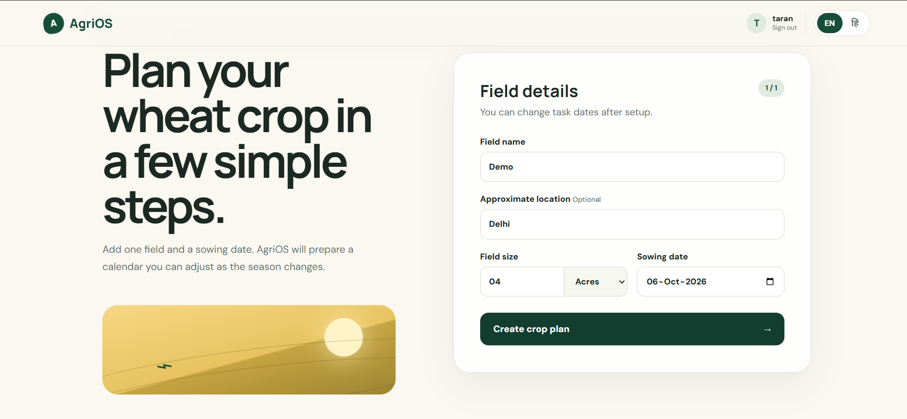
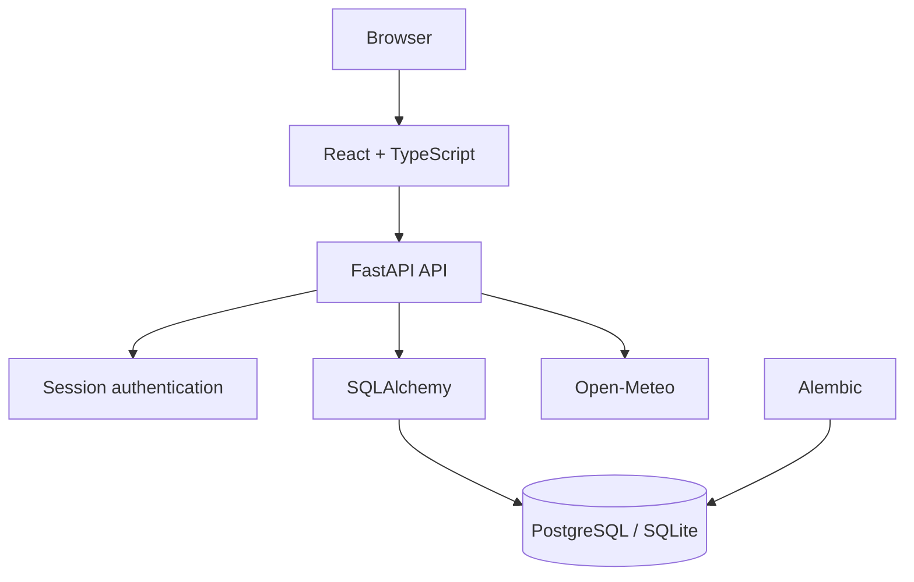

# AgriOS

[](https://github.com/taran-ghub/AgriOS/actions/workflows/ci.yml)

### [Open the live application](https://agrios-9tvg.onrender.com)

AgriOS is a multilingual, mobile-first farm operations assistant. It helps users plan crop cycles, manage daily tasks and record irrigation, expenses, harvests and sales through one authenticated workspace.

> The bundled crop schedules are development samples—not agricultural advice. Farmer-facing schedules require reviewed, regional agronomic sources.

## Product preview

| Field and crop setup | Today’s tasks |
|---|---|
|  |  |

| Farm records | Mobile interface |
|---|---|
|  |  |

## Features

- Secure account registration, login and logout
- Owner-scoped fields, crop cycles, tasks and farm records
- Field area support in acres and kanal
- Wheat crop-cycle planning from a sowing date
- Editable task calendar
- Overdue, today and upcoming task groups
- Irrigation history
- Expense tracking and cost totals
- Harvest and sales records
- Recorded income, expense and balance summary
- Harvested-versus-sold quantity checks
- Three-day weather forecasts using Open-Meteo
- Indian town and city search
- English and Hindi interface support
- Links to official agricultural portals
- Responsive, mobile-first interface
- PostgreSQL-backed production persistence

## Architecture



The production Docker image first compiles the React application and then packages it with the FastAPI backend. FastAPI serves both the REST API and the built frontend.

## Engineering decisions

### Owner-scoped data access

Each field, crop cycle and record belongs to an authenticated account. Authorization is enforced by backend database queries rather than relying on the frontend to hide inaccessible records.

### Revocable authentication sessions

AgriOS uses opaque session tokens stored in the database. Tokens are hashed before storage and can be revoked during logout. Browser sessions are delivered using secure HTTP-only cookies.

### Password security

Passwords are processed with PBKDF2 and individual salts. Plain-text passwords are never stored.

### Safe numeric storage

Money and farm quantities are normalized to integer units before storage, avoiding floating-point calculation errors.

### Database migrations

Alembic tracks schema changes in version-controlled migration files. Pending migrations run before the production server starts.

### Production database testing

Local development uses SQLite for simple setup, while production uses PostgreSQL. GitHub Actions starts a temporary PostgreSQL 16 service to test database compatibility.

### Containerized deployment

A multi-stage Docker build compiles the frontend and creates a smaller Python runtime image. The application runs as a non-root container user.

### Service monitoring

AgriOS exposes separate endpoints for application liveness and database readiness:

```text
GET /health
GET /health/ready
```

The readiness check executes a small database query so the hosting platform can detect database connectivity failures.

## Technology

| Area | Technology |
|---|---|
| Frontend | React, TypeScript, Vite |
| Backend | FastAPI, Python 3.11 |
| Validation | Pydantic |
| Database | PostgreSQL, SQLite |
| ORM | SQLAlchemy |
| Migrations | Alembic |
| Authentication | PBKDF2, opaque sessions, HTTP-only cookies |
| Testing | Pytest, FastAPI TestClient |
| Quality | Ruff, ESLint, TypeScript |
| Infrastructure | Docker, GitHub Actions, Render |
| External API | Open-Meteo |

## Continuous integration

Every push and pull request runs four independent checks:

1. Backend test suite
2. PostgreSQL integration test
3. Frontend TypeScript production build
4. Docker image build

## Run locally

### Backend

From the repository root:

```bat
conda create -n agrios python=3.11 -y
conda activate agrios
pip install -r backend\requirements-lock.txt
alembic upgrade head
uvicorn backend.app.main:app --reload
```

The API will be available at:

```text
http://127.0.0.1:8000
```

Interactive API documentation:

```text
http://127.0.0.1:8000/docs
```

Without `DATABASE_URL`, the backend automatically uses SQLite.

### Frontend

In another terminal:

```bat
cd frontend
npm install
npm run dev
```

Open:

```text
http://127.0.0.1:5173
```

Vite forwards `/api` requests to the local FastAPI server.

## Environment variables

| Variable | Purpose |
|---|---|
| `DATABASE_URL` | Production PostgreSQL connection |
| `APP_ENV` | Enables production security settings |
| `APP_ORIGINS` | Trusted browser origins |
| `PORT` | Container HTTP port |
| `TEST_DATABASE_URL` | Isolated PostgreSQL integration database |

Never commit environment values, credentials or database URLs.

## Verify the project

Backend:

```bat
pytest
ruff check backend
ruff format backend --check
```

Frontend:

```bat
cd frontend
npm run lint
npm run build
```

The PostgreSQL test is intentionally skipped locally unless `TEST_DATABASE_URL` is configured. CI provides its own isolated PostgreSQL database.

## Main API groups

| Route | Responsibility |
|---|---|
| `/api/auth` | Authentication and sessions |
| `/api/crop-cycles` | Fields, crop plans and tasks |
| `/api/irrigation` | Irrigation records |
| `/api/expenses` | Expense records |
| `/api/harvests` | Harvest records |
| `/api/sales` | Sale records |
| `/api/records` | Combined summaries |
| `/api/today` | Daily task overview |
| `/api/weather` | Location search and forecasts |

The complete OpenAPI specification is available through `/docs`.

## Current limitations

- Crop-task schedules are sample development data.
- The current crop workflow focuses on wheat.
- Account recovery and email verification are not yet available.
- Weather data depends on the availability of Open-Meteo.
- The free deployment may require a short wake-up period after inactivity.
- A protected read-only demonstration mode is planned but not yet available.

## Roadmap

- Add an isolated read-only demonstration workspace
- Add rate limiting to authentication and public endpoints
- Replace sample schedules with reviewed agronomic sources
- Support additional crops and regional templates
- Add seasonal PDF/CSV reports
- Add account recovery and email verification
- Improve offline and low-connectivity support
- Conduct structured usability testing with farmers